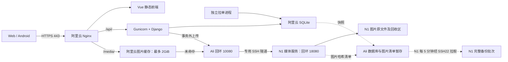

# WeWin 电商 ERP 管理系统

WeWin 是一套面向多企业的电商运营管理系统，围绕**手串（串珠 / 配件 / 成品）与童装**两条商品线，提供企业隔离、店铺管理、1688 订单拉取、商品 BOM 与成本核算、客户报价、销售利润统计，并配套 Web 后台与 Android 客户端。

---

## 功能特性

| 模块 | 能力 |
| --- | --- |
| 企业与权限 | 多企业数据隔离；6 类用户角色；页面可见性配置；JWT 登录认证 |
| 店铺管理 | 多平台店铺维护（1688 已接入）；平台 API 凭证配置；手动/定时拉单；拉单任务记录 |
| 订单管理 | 1688 订单列表与详情同步；收货人、商品项、物流、评价等完整明细；保留平台原始 JSON |
| 商品管理 | 串珠、手串配件、手串成品、童装四类商品；SKU 管理；商品图片上传 |
| 成本核算 | 成品 BOM（串珠 + 配件）成本自动重算；成本变更历史快照；利润与利润率展示 |
| 童装成本表 | 类 Excel 成本矩阵（行=货号、列=尺码），支持筛选、搜索、排序、冻结列与批量保存 |
| 客户与报价 | 客户档案；客户可见商品配置；客户专属报价与报价历史 |
| 数据看板 | 商品统计概览 |
| 移动端 | Android 原生客户端：登录、四类商品/SKU、童装尺码、成品BOM与克价模拟、图片与个人信息 |
| 辅助工具 | 1688 订单/利润汇算脚本；企业微信销售日报推送 |

> 说明：Web 端「库存管理」「销售数据」目前为占位页面，功能尚未实现。

---

## 技术栈

### 后端

- Python 3.10+（当前环境 3.12）
- Django 5.2.19（未使用 Django REST Framework）
- PyJWT 2.8.0（HS256，手写认证装饰器）
- SQLite（默认数据库）
- django-cors-headers、python-dotenv、Pillow、APScheduler、openpyxl

### Web 前端

- Vue 3.5 + Vite 4
- Element Plus 2.13 + @element-plus/icons-vue
- Pinia（状态管理）、vue-router（history 模式）
- Axios（统一封装）、ECharts、Handsontable、xlsx + file-saver

### Android

- Kotlin + Jetpack Compose（Material3）
- Retrofit + OkHttp + kotlinx-serialization
- DataStore（Token 持久化）、Coil、Navigation Compose

原生端当前覆盖商品管理和个人信息；订单、客户报价等独立页面使用Web后台。童装在原生端以商品/尺码表单编辑。功能和构建详见 [Android/README.md](Android/README.md)。

### N1 媒体服务

- Go 标准库，使用 Go 1.27.4 构建 ARM64 独立程序
- 原文件读写、内容哈希、原子发布、受限空间与删除回收区
- 经专用反向 SSH 隧道提供内部媒体接口，阿里云 Nginx 统一代理和缓存

### 独立脚本

- Python + requests 直连 1688 OpenAPI
- openpyxl 处理成本与利润 Excel
- 企业微信机器人 Webhook 推送

---

## 系统架构



图中箭头表示请求或数据流向；媒体 SSH 隧道由 N1 主动连接阿里云22建立。FRP7000/6000保留为独立管理通道。`AliData/` 是独立1688汇算/推送工具，不参与在线图片链路。

- 数据库保留在阿里云，图片原文件存放N1；阿里云只保留有界缓存和上传临时文件。
- 图片URL仍为同一HTTPS入口。缓存未命中时，Nginx经隧道读取N1原图、返回浏览器并缓存，不经过Django。
- N1媒体失联时，缓存图可读；未缓存图与图片写操作503，核心业务按独立依赖继续运行。
- 业务表通过 `company` 外键隔离，JWT有效期7天；自动拉单使用独立 `run_scheduler` 进程。
- 数据库快照和媒体清单备份不包含图片内容。N1回收区最多7天/5GiB，仍需独立设备备份来覆盖硬件损坏。

---

## 目录结构

```
WeWin/
├── Server/                       # Django 后端（:8003）
│   ├── wewin/                    # 项目配置（settings / urls / wsgi）
│   ├── account/                  # 用户、认证、角色、页面配置
│   ├── company/                  # 企业管理
│   ├── customer/                 # 客户、报价、可见性
│   ├── store/                    # 店铺 / 商品 / 订单 / 拉单
│   │   ├── models/               # store / product / order / data_pull
│   │   ├── views/                # helpers / store_views / product_views / order_views
│   │   ├── services/             # 拉单服务基类与 1688 实现
│   │   ├── management/commands/  # 商品导入、成本历史初始化
│   │   ├── tasks.py              # 自动拉单任务
│   │   └── apps.py               # 应用注册，不在此启动调度
│   ├── utils/decorators.py       # jwt_required / permission_required 等
│   ├── utils/media.py            # 上传事务、引用更新和清理队列
│   ├── utils/remote_media.py     # N1 存储适配
│   ├── manage.py
│   └── requirements.txt
├── Page/                         # Vue 3 前端
│   ├── src/
│   │   ├── api/                  # 模块化 API 客户端
│   │   ├── views/                # 页面（products / stores / components）
│   │   ├── layout/               # 主布局（侧边栏 + 顶栏）
│   │   ├── router/               # 路由与登录/权限守卫
│   │   └── store/                # Pinia 状态
│   ├── serve_spa.py              # 历史本地预览工具（不用于当前生产）
│   └── vite.config.js
├── Android/                      # Kotlin + Compose 原生客户端
├── AliData/                      # 1688 独立脚本（拉单、利润汇算、企微推送）
├── media-service/                # N1 图片存储程序（Go）
│   ├── main.go                  # 原图读写、校验、回收区和清单
│   └── main_test.go / go.mod
├── deploy/                       # 部署和运维工具
│   ├── nginx.conf / *.service / *.timer
│   ├── n1/                      # 媒体监督、备份客户端安装
│   ├── backup.py / backup_exchange.py / restore_backup.py
│   └── N1-MEDIA.md               # 在线图片部署、迁移及恢复
├── docs/                         # 验收/整合记录、CODE_WIKI.md、提交日志 log.txt
├── document/                     # 业务与 1688 API 相关文档
├── .trae/                        # 规划文档与 specs
├── start.sh / stop.sh            # 一键启停脚本
├── start_backend.sh              # 后端启动脚本
├── start_frontend.sh             # 前端启动脚本（Nginx）
├── start_wxwork.sh               # 企微定时任务启动脚本
└── Makefile
```

---

## 当前生产部署

生产入口为 **https://47.250.165.79**。阿里云运行Nginx、Gunicorn、独立调度和SQLite，N1存放在线图片原文件并运行媒体服务；阿里云缓存上限2GB。线上数据库位于 /var/lib/wewin，原图位于N1 wewin-media/objects，运行代码在 /srv/wewin/app；发布时独立管理代码与数据。

| 组成 | 源码入口 |
| --- | --- |
| 前端 | Page/；deploy/build_frontend.py |
| 后端 | Server/；deploy/app.env.example；deploy/sync_runtime.py |
| 在线图片存储 | media-service/；Server/utils/remote_media.py；Server/utils/media.py |
| 备份与恢复 | deploy/backup.py、backup_exchange.py、restore_backup.py |
| N1 运行监督 | deploy/n1/run_media.py；deploy/n1/install_backup.py |
| 统一运维 | start.sh、stop.sh、deploy/service_control.py；Makefile |

完整指引见 [DEPLOYMENT.md](DEPLOYMENT.md)、[部署导航](deploy/README.md)、[N1在线图片部署](deploy/N1-MEDIA.md) 和 [N1备份安装](deploy/n1/README.md)。

| 对象 | 生产位置 | 容量或规则 |
| --- | --- | --- |
| SQLite | Ali /var/lib/wewin/db.sqlite3 | 唯一在线主库 |
| 图片原文件 | N1 ~/Documents/workplace_shop/wewin-media/objects/products | 不长期保留在阿里云 |
| 图片缓存 | Ali /var/cache/wewin-media | 独立2GiB硬上限，淘汰目标1.5GiB |
| 上传暂存 | Ali /var/lib/wewin-upload | 独立512MiB硬上限 |
| 数据库/清单备份暂存 | Ali /var/backups/wewin | 512MiB预算检查，超限停止新增 |
| 图片回收区 | N1 objects/.trash | 最多7天及5GiB，不等同独立备份 |

源码提交与业务数据录入分别管理：生产数据库、图片、实际凭据和备份归档保存在仓库外，Git推送用于发布代码。

## 快速开始（开发环境）

后端使用Python3.10+（推荐3.12），前端使用Node.js18+。激活虚拟环境后执行：

```bash
cd Server
python3 -m venv venv
source venv/bin/activate
pip install -r requirements.txt
cp .env.example .env
python manage.py migrate
python manage.py create_superadmin       # 开发账号，使用前设置安全密码
python manage.py init_page_config
python manage.py runserver 127.0.0.1:8003
```

另一个终端启动前端：

```bash
cd Page
npm ci
npm run dev
```

开发API默认 http://127.0.0.1:8003，需要覆盖时设置 Page/.env.local 中的 VITE_API_BASE_URL。生产默认同源HTTPS，不直接访问公网8003。

Android构建默认HTTPS入口，可显式指定环境：

```bash
bash Android/gradlew -p Android -PAPI_BASE_URL=https://47.250.165.79 assembleDebug
```

配置本机Android SDK后构建；APK在 Android/app/build/outputs/apk/debug。已在 P0110（Android17）验证登录、商品/SKU、童装、BOM和图片操作；见 [真机验证记录](docs/android-device-validation-2026-11-26.md)。正式签名发布另行配置。

## 生产运维入口

```bash
bash start.sh --dry-run                  # 预览范围
bash start.sh                            # 启动已安装的systemd服务
python3 deploy/service_control.py all status
bash stop.sh --dry-run                   # 预览停止范围
```

各端单独使用 start/stop_frontend.sh、start/stop_backend.sh、start/stop_data.sh。start_services.py保留为生产启动兼容入口。本地开发可使用 make run-backend、make run-frontend。企微独立脚本 start/stop_wxwork.sh 不受这些入口影响。

## 配置说明

| 配置 | 作用 |
| --- | --- |
| Server/.env.example | 本地后端配置示例 |
| deploy/app.env.example | 生产配置参考；实际存放在仓库外 /etc/wewin/app.env |
| WEWIN_ENV_FILE | 显式选择后端环境文件 |
| DB_ENGINE / DB_NAME 等 | SQLite 或预留的 MariaDB 配置；当前生产使用云侧SQLite |
| MEDIA_ROOT / MEDIA_URL | 开发本地媒体目录；生产客户端HTTPS图片入口 |
| MEDIA_ORIGIN_URL / MEDIA_ORIGIN_READ_TOKEN / MEDIA_ORIGIN_WRITE_TOKEN | 生产N1回环源地址及独立读取/写入凭据 |
| MEDIA_CACHE_ROOT / FILE_UPLOAD_TEMP_DIR | 阿里云有界缓存及上传暂存 |
| MEDIA_CLEANUP_DIR | 持久清理队列位置 |
| Page/.env.production.example | Web同源生产API配置示例 |
| API_BASE_URL / WEWIN_API_BASE_URL | Android通过Gradle参数或环境变量覆盖API地址 |

生产 DEBUG=False，需要稳定的强 SECRET_KEY、明确的 ALLOWED_HOSTS，以及仓库外的数据库和媒体路径。密钥、实际环境文件、媒体及构建产物不提交。

---

## 常用命令

### Django 管理命令

| 命令 | 说明 |
| --- | --- |
| `python manage.py create_superadmin` | 创建默认网站超级管理员 |
| `python manage.py init_page_config` | 初始化各用户类型的页面可见性 |
| `python manage.py update_enterprise_admin_to_leader` | 将历史企业管理员数据迁移为企业负责人 |
| `python manage.py import_children_clothing` | 从 Excel 导入童装商品 |
| `python manage.py init_finished_cost_history` | 为现有成品初始化成本历史记录 |
| `python manage.py migrate` | 执行数据库迁移 |

### 数据库快照与媒体清单备份

生产备份由 wewin-backup.timer 每小时执行，N1每5分钟拉取，归档仅包含数据库与图片清单，不打包原图。手动运行使用 `systemctl start wewin-backup`。联合恢复使用 `deploy/restore_backup.py` 并指定 `--media-root` 对N1原文件/回收区核对哈希；只恢复数据库与清单时不能声明原图已恢复。旧 `Server/backup_db.py` 仅用于开发SQLite备份。

### 服装利润汇算（AliData）

```bash
cd AliData
python profit_counting.py \
  --start 2026-11-01 --end 2026-11-30 \
  --shops "店铺名" \
  --send --export-profit --export-summary
```

| 参数 | 说明 |
| --- | --- |
| `--start` / `--end` | 统计起止日期（`YYYY-MM-DD`） |
| `--shops` | 指定店铺名，多个可用逗号分隔 |
| `--send` | 推送汇总到企业微信 |
| `--export-profit` | 导出每单利润明细 |
| `--export-summary` | 导出总账汇总 |

---

## API 约定

统一前缀：`/api/<app>/`，返回格式为 `JsonResponse`。

| 前缀 | 说明 |
| --- | --- |
| `/api/account/` | 登录、注册、当前用户、改密、用户管理、页面配置 |
| `/api/company/` | 企业 CRUD、企业用户、批量状态 |
| `/api/store/` | 店铺、API 配置、拉单、订单、商品、SKU、成本历史、童装成本 |
| `/api/customer/` | 客户 CRUD、客户商品与报价、可见性配置 |

约定：

- 业务接口统一使用 `@jwt_required` 校验登录，必要时叠加 `@permission_required` / `@admin_required`。
- 请求头携带 `Authorization: Bearer <token>`。
- 成功返回业务数据对象，失败返回 `{"error": "错误信息"}`。
- 所有查询按 `request.user.company` 过滤，禁止跨企业访问。
- 前端统一通过 `src/api/` 下的模块调用，不直接使用 Axios。

示例：

```
POST /api/account/login/
GET  /api/store/products/?product_type=finished
GET  /api/store/products/12/cost-history/
GET  /api/store/3/orders/?page=1
```

---

## 核心数据模型

```
Company
├── User（super_admin / site_admin / enterprise_leader /
│         enterprise_admin / enterprise_user / temporary）
├── Store
│   ├── PlatformApiConfig
│   ├── StoreDataConfig
│   ├── DataPullTask
│   ├── StoreData
│   └── Order
│       ├── OrderItem / OrderReceiver / OrderContact
│       ├── OrderStep / OrderTradeTerm
│       ├── OrderRateInfo / OrderBizInfo
│       └── OrderLogistics → OrderLogisticsItem
├── Product（product_type: bead / accessory / finished / children_clothing）
│   ├── ProductSku
│   ├── Bead / Accessory / FinishedProduct / ChildrenClothing
│   ├── FinishedProductBead / FinishedProductAccessory（BOM）
│   └── FinishedProductCostHistory（成本快照）
└── Customer
    ├── CustomerVisibility
    ├── CustomerProduct
    └── CustomerPriceHistory
```

要点：

- 商品采用「基础表 + 类型扩展表」：`Product` 存通用字段，四类详情各用 OneToOne 扩展。
- 成品通过 `FinishedProductBead` / `FinishedProductAccessory` 记录组成与数量，成本变动时自动重算并写入历史快照。
- 订单采用「主表 + 扩展表」，并在 `platform_raw_data` 中保留平台原始数据。
- 表名通过 `Meta.db_table` 显式指定，且均为单数形式（如 `product`、`order`）。

---

## 支持的平台

| 平台 | 状态 |
| --- | --- |
| 1688 | 已实现订单拉取 |
| 淘宝 / 天猫 / 京东 / 拼多多 / 抖音 / 快手 / 小红书 / 微信小店 | 模型已预留，拉单服务待实现 |

新增平台：在 `Server/store/services/` 继承 `BaseDataPullService`，实现 `pull_orders`、`pull_order_detail`、`save_order`，并在 `get_service_class` 中注册。

---

## 定时任务

| 任务 | 触发方式 | 说明 |
| --- | --- | --- |
| 店铺自动拉单 | APScheduler，每 1 分钟检查 | 读取 `StoreDataConfig.auto_pull_enabled` 与 `pull_interval_hours` 决定是否拉取 |
| 企微销售推送 | 独立进程，每日 00:03 | 由 `start_wxwork.sh` 启动 `AliData/hooks/wxwork.py` |

自动拉单由 wewin-scheduler.service 独立运行，Web worker不启动调度。需要本地运行时执行 `python manage.py run_scheduler`。

---

## 部署与端口

统一生产启停、构建、代码同步和N1安装步骤见 [DEPLOYMENT.md](DEPLOYMENT.md)。阿里云已安装systemd单元后，在仓库根目录使用 `bash start.sh` 和 `python3 deploy/service_control.py all status`。

| 服务 | 端口与范围 |
| --- | --- |
| 生产Web/API | 443 HTTPS；80跳转与证书验证 |
| Gunicorn | 127.0.0.1:8003，仅由Nginx访问 |
| 前端开发 | 5173 |
| N1媒体隧道/备份拉取 | 阿里云SSH22，限制来源 |
| 私有媒体端口 | Ali 127.0.0.1:10080 → N1 127.0.0.1:18080，不开放公网 |
| N1管理FRP | 7000接入，6000转发SSH，限制来源 |

线上数据库位于阿里云 `/var/lib/wewin`，图片原文件位于N1 `wewin-media/objects`。图片部署与故障表现见 [deploy/N1-MEDIA.md](deploy/N1-MEDIA.md)。开发环境使用 Django runserver 与 Vite，生产使用Nginx/Gunicorn及独立调度。

---

## 验证与健康检查

```bash
# 后端：在准备好开发/测试Python环境后运行
cd Server
python manage.py test store.test_deployment store.test_remote_media --noinput
cd ..
python3 -m unittest discover -s deploy -p 'test_*.py'

# N1媒体模块：在Go构建环境中运行
cd media-service
go test -race ./...
```

Android变更在实际SDK环境中构建并静态检查，再安装到指定设备进行功能复验：

```bash
ANDROID_HOME=/path/to/android-sdk bash Android/gradlew -p Android \
  -PAPI_BASE_URL=https://47.250.165.79 assembleDebug lintDebug
adb devices -l
adb -s <serial> install -r Android/app/build/outputs/apk/debug/app-debug.apk
```

P0110 / Android17已验证登录、搜索分页、四类商品、SKU保留、图片、BOM、删除保护、离线恢复和会话持久化。完整结果与限制见 [真机验证报告](docs/android-device-validation-2026-11-26.md)。

健康检查为 `/health/live/`、`/health/core/`、`/health/media/`、`/health/ready/`、`/health/backup/`。分别观察进程、数据库核心依赖、N1媒体、整体依赖和备份新鲜度。备份任务结果还需查看systemd日志，不能仅以备份健康200判定最近一次任务成功。

---

## 项目文档

- [AGENTS.md](AGENTS.md)：面向开发者的仓库导航、约定与常见任务指引
- [docs/CODE_WIKI.md](docs/CODE_WIKI.md)：逐模块代码导读
- [docs/log.txt](docs/log.txt)：提交日志（倒序）
- [DEPLOYMENT.md](DEPLOYMENT.md)：部署与启停脚本说明
- [deploy/N1-MEDIA.md](deploy/N1-MEDIA.md)：图片服务、专用隧道、缓存、迁移与恢复
- [docs/n1-media-validation-2026-11-26.md](docs/n1-media-validation-2026-11-26.md)：N1图片部署验收记录
- [docs/android-device-validation-2026-11-26.md](docs/android-device-validation-2026-11-26.md)：Android真机验证与修复记录
- [document/](document/)：数据库设计、1688 API、业务模块等原始文档
- [.trae/specs/](.trae/specs/)：各功能模块的需求与实现规格

---

## 安全与注意事项

1. **生产环境必须修改 `SECRET_KEY`**，并将 `DEBUG` 设为 `False`、收敛 `ALLOWED_HOSTS` 与 CORS 白名单。
2. `AliData/global_params.py` 含 1688 店铺凭证，`Server/.env`、`Page/.env.local` 含敏感配置，禁止提交到公开仓库。
3. 数据库当前为 SQLite；高并发或多人协作场景建议迁移到 PostgreSQL / MySQL。
4. 仓库中的 `Server/db.sqlite3` 及备份文件可能包含真实业务数据，请勿随代码分发。
5. 部署回归测试为 `Server/store/test_deployment.py`、`Server/store/test_remote_media.py`、`deploy/test_backup.py` 和 `media-service/main_test.go`；其他 `Server/` 下的 `check_*.py`、`create_*.py`、`test_*.py` 多为一次性运维脚本，应核实用途后执行。
6. 提交代码后需按约定更新 `docs/log.txt`（倒序，每个 commit 一条），详见 [AGENTS.md](AGENTS.md)。
